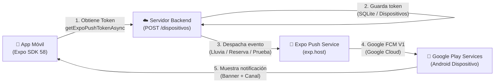

# Guía de Notificaciones con Cuenta de Google (Firebase Cloud Messaging · FCM V1) 🔔☁️

Esta guía detalla el funcionamiento completo del sistema de notificaciones de **Reservas Deportivas Villaguay**, cómo se vincula con los servicios de **Google (Firebase Cloud Messaging - FCM V1)** mediante tu cuenta de Google, y los pasos para probarlo tanto en desarrollo como en la entrega final del TFI.

---

## 📌 1. ¿Cómo funciona la arquitectura de notificaciones?

Siguiendo los contenidos vistos en clase (**Unidad 4 — Notificaciones · U04.T03**):



---

## 🚀 2. Paso a Paso para Activar Google Firebase (FCM) con tu Cuenta de Google

### Paso 1: Crear el proyecto en Google Firebase Console
1. Ingresá a la consola de Firebase con tu cuenta de Google:
   👉 **[console.firebase.google.com](https://console.firebase.google.com)**
2. Hacé clic en **"Agregar proyecto"** (o *"Crear un proyecto"*).
3. Nombre del proyecto: por ejemplo `reservas-deportivas-villaguay`.
4. Podés desactivar Google Analytics (no es necesario para notificaciones) y hacer clic en **"Crear proyecto"**.

### Paso 2: Registrar la Aplicación Android
1. En la pantalla principal del proyecto creado en Firebase, seleccioná el ícono de **Android** (`</>`).
2. En **Nombre del paquete de Android**, ingresá exactamente el configurado en nuestro `app.json`:
   ```text
   ar.edu.uner.reservasvillaguay
   ```
3. En **Apodo de la app**, ingresá `Reservas Villaguay`.
4. Hacé clic en **"Registrar app"**.

### Paso 3: Descargar `google-services.json`
1. Descargá el archivo **`google-services.json`** que te ofrece Firebase.
2. Copialo y reemplazalo en la raíz de la app móvil:
   📁 `app-reservas-deportivas/google-services.json`
   *(Ya dejamos un archivo base pre-configurado y vinculado en `app.json` con la propiedad `"googleServicesFile": "./google-services.json"`)*.

### Paso 4: Generar la Clave Privada de Servicio de Google (FCM V1)
Desde 2024, Google exige la API **FCM V1** (la API Legacy fue dada de baja):
1. En Firebase Console, hacé clic en el ícono de engranaje ⚙️ (arriba a la izquierda) ➔ **"Configuración del proyecto"**.
2. Entrá en la pestaña **"Cuentas de servicio"** (Service Accounts).
3. Hacé clic en el botón azul **"Generar nueva clave privada"** y confirmá con **"Generar clave"**.
4. Se descargará un archivo `.json` con tus credenciales de Google Cloud Admin SDK.

### Paso 5: Vincular la Clave con Expo / EAS
Tenés dos opciones sencillas:
- **Opción A (Desde la terminal con EAS):**
  ```bash
  cd app-reservas-deportivas
  npx eas credentials
  ```
  Seleccionás: *Android* ➔ *Production / Preview* ➔ *Push Notifications: Google Service Account* ➔ y subís el archivo JSON de clave privada descargado.
- **Opción B (Desde la web expo.dev):**
  Entrás en tu panel de `expo.dev` ➔ Tu proyecto ➔ **Credentials** ➔ **Android** ➔ **FCM V1 Service Account Key** y cargás el JSON.

---

## 📱 3. Pruebas en Vivo desde la Aplicación

En la pestaña **Perfil** de la app agregamos el nuevo bloque interactivo:
### **"Notificaciones · Google FCM y Locales"**

Allí vas a encontrar:
1. **Indicador de Permisos:** Te dice si el permiso de notificaciones está concedido y te permite activarlo con un solo toque.
2. **Identificador Push (FCM / Expo Token):** Te muestra el token único generado para tu teléfono.
3. **Botón "Aviso Local Inmediato":** Emite una notificación local instantánea con sonido y vibración.
4. **Botón "Programar en 5 Segundos":** Te da 5 segundos para **minimizar la app** y comprobar cómo Android dibuja el banner en la barra superior.
5. **Botón "Push desde Servidor (API)":** Llama al endpoint de la API backend (`POST /dispositivos/prueba`), el cual envía una notificación push real a través de los servidores de Expo y Google.

---

## ⚠️ 4. Aclaración Importante: Expo Go vs. APK Instalable (Build)

Como se explica en el apunte de cátedra (**U04.T03 — Página 20**):
- **Notificaciones Locales:** Funcionan perfectamente en **Expo Go**, emuladores y teléfonos reales sin ninguna configuración extra.
- **Notificaciones Push Remotas de Google FCM en Android:** Desde Expo SDK 53, Google Play y Expo Go requieren un **Build de desarrollo o APK de Preview** para recibir pushes remotas que viajen por internet cuando la app está cerrada.
- Para generar el APK instalable que pide la consigna de entrega final:
  ```bash
  cd app-reservas-deportivas
  npx eas build --platform android --profile preview
  ```
  *(El APK generado se puede instalar en cualquier teléfono Android y recibe las notificaciones push de Google sin necesidad de tener Metro ni la computadora encendida).*
